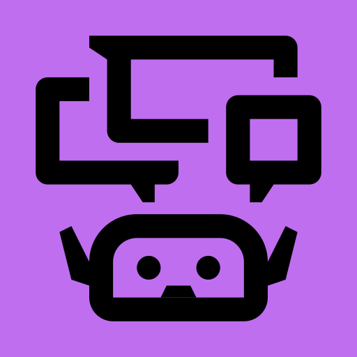
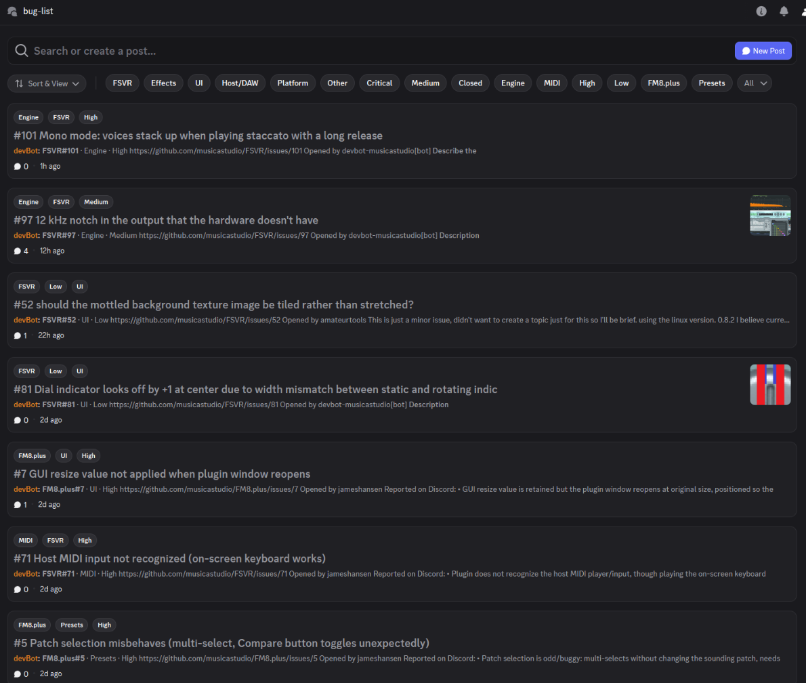
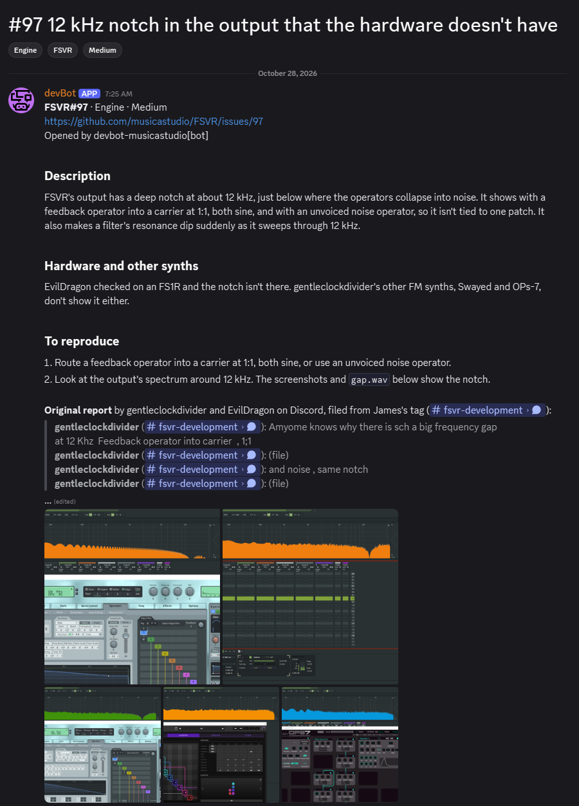
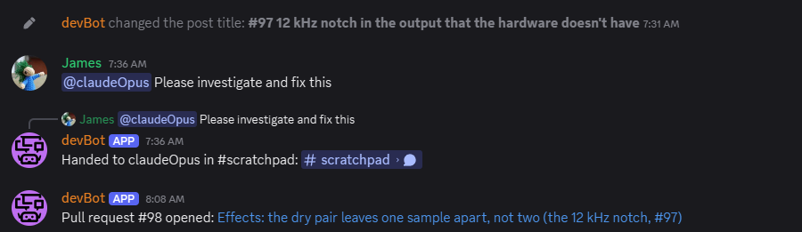
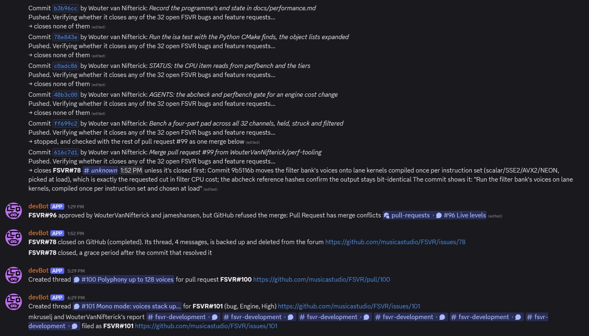
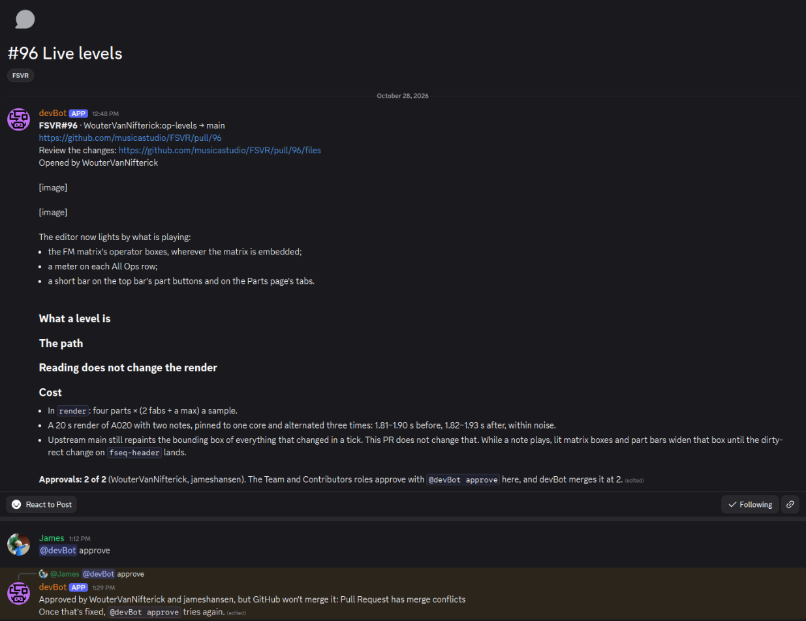
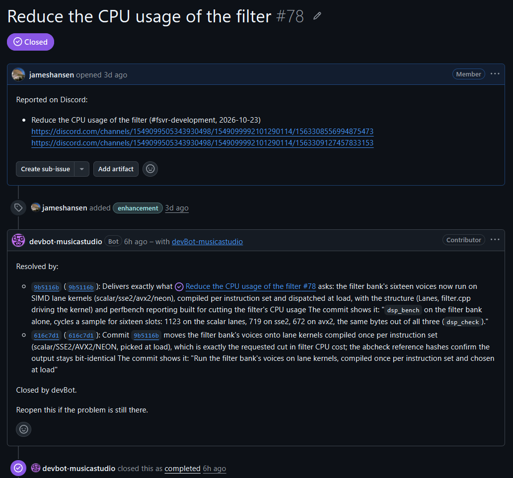

<p align="center"></p>

<h1 align="center">devBot</h1>

<p align="center"><b>A Discord bot that keeps a community's bug and feature lists in step with GitHub, and checks the work with AI models.</b><br>Built for the <a href="https://github.com/musicastudio/FSVR">FSVR</a> and <a href="https://github.com/musicastudio/FM8.plus">FM8.plus</a> projects at musica.studio.</p>

<p align="center"><a href="https://github.com/apps/devbot-musicastudio"><b>devBot on GitHub</b></a> · <a href="https://discord.gg/6sXu3GmkNm"><b>See it at work on the musica.studio Discord</b></a></p>



## What it does

Most bug reports in a small open-source project start as a message in Discord, and plenty never make it to the tracker. devBot closes that gap. Every open GitHub issue gets its own forum thread, a tag on any Discord message files it as an issue, and every commit pushed to main is checked against the open issues so the ones it fixes close with the line from the commit that proves it.

It also runs the handoffs around the work. An issue can be handed to a coding agent with a brief attached, pull requests get their own threads, and a pull request merges once 2 different people approve it in Discord.

## Features

- **Issues as forum threads.** Every open issue has a thread in the bug-list or feature-list forum, tagged with product, category and importance. Images in the issue are attached to the thread. A closed issue's thread is backed up with every message and file, then removed from the forum, and reopening the issue picks the conversation back up from the backup.
- **File a report with one tag.** `@devBot` in a reply, with a link to a message, or with the report written after it, files the messages it points at. devBot reads the 25 messages before the tag, writes the report from the ones about the same problem, credits whoever wrote them, and splits unrelated problems into separate issues. A report that matches an open issue is added to that issue's thread instead.
- **Two-way comments.** A message in an issue's thread goes to GitHub as a comment, quoted and credited with a link back, along with its files. Comments made on GitHub come back to the thread.
- **Commits close issues, with evidence.** Each pushed commit, or each merged pull request as a whole, is checked against its repository's open issues. An issue only closes after 2 confirmations that each quote a line that really appears in the commit or its diff, and after a 30 minute grace period. The closing comment on GitHub lists the commits and what each one shows.
- **Hand work to a coding agent.** Tagging the coding agent in an issue's thread, or asking devBot for work on an issue, posts the request with a brief attached: the GitHub issue, its comments, the whole Discord thread and its images. The agent works on a branch named for whoever asked, asks in the thread before opening a pull request, and a person merges it.
- **Pull requests merge at 2 approvals.** Every open pull request has a thread with the branch, a link to review the changes and the approvals so far. Team and Contributors members approve with `@devBot approve`. A pull request opened by a team member counts as their approval, a new push starts the approvals over, and the merge is pinned to the approved commit so GitHub refuses it if the branch moved. The Team role can merge without the second approval with `@devBot force approve <reason>`, and the reason goes to the pull request as a comment and into the merge commit.
- **Edit issues from Discord.** `@devBot correct #92's 'full-mesh algorithm' to 'full-mesh custom algorithm'` applies exactly the change asked for, retitles the thread and notes on GitHub who changed what.
- **Files that last.** Discord's attachment links expire and GitHub's API can't attach files to issues, so devBot copies every file to a `devbot-files` branch in the repository and links it from there.
- **The website's contact form.** Messages from the musica.studio contact form are sorted into bug reports, feature requests and everything else. Reports go through the same duplicate check, and the public issue leaves out names, email addresses and phone numbers.
- **Everything in the open.** devBot posts what it does in a #devbot channel: new threads, closes and reopens, filed reports, pull requests, and each commit as "Pushed. Verifying..." edited to its outcome.

| An issue thread | The handoff to the coding agent |
| --- | --- |
|  |  |



| Approving a pull request | The close on GitHub |
| --- | --- |
|  |  |

## How a commit closes an issue

1. A push to main is checked against the open issues in its repository. A merged pull request is checked once, with the messages of all its commits and its diff against main.
2. `glm-5.3-flash` reads the commit message and the diff, since a message can leave out what the code makes plain, and links the commit to the issues it touches.
3. `glm-5.3` judges each of those issues twice, with the whole issue, its comments and the commit. Each confirmation has to quote a sentence that appears in the commit or its diff, so an issue reported after the commit, one waiting on its reporter or one the commit only explains stays open.
4. A confirmed close waits 30 minutes, since the session that made the commit often explains the fix and closes the issue itself. Another commit resolving the same issue in that time joins the close and restarts the wait.
5. When the time is up, an issue someone already closed is left alone, one somebody commented on since the commit closes quietly, and any other gets one comment listing the commits before it closes.

`gate_test.py` runs step 3 over commit and issue pairs whose answers were checked by hand, and prints the wrong closes and missed fixes for each model. It runs whenever the prompt or the model changes.

## Commands

| Command | Where | What it does |
| --- | --- | --- |
| `@devBot` with a report, a reply or a message link | anywhere | Files the report as an issue, or adds it to a matching issue's thread |
| `@devBot <change to FSVR#91>` | anywhere, or in an issue's thread | Applies the change to the issue's title and body |
| `@devBot add image` | in an issue's thread, or with an issue named | Adds the files on your message, or the one you reply to |
| `@devBot close` | in an issue's thread, or with an issue named | Closes the issue, with a comment on GitHub naming who closed it |
| `@devBot delete` | in an issue's thread, or with an issue named | Removes an issue filed in error, after a ✅ |
| `@devBot approve` | in a pull request's thread | Approves the pull request, and merges it at 2 approvals |
| `@devBot force approve <reason>` | in a pull request's thread | Merges the pull request now, with the reason on GitHub and in the merge commit. Team role only |

Closing and deleting need permission to manage threads. A close from someone without it goes into the thread for a maintainer to confirm.

## Run your own

devBot is written for musica.studio's server, so the channel, forum and role IDs at the top of `bot.py` are the first thing to change.

1. **Create a Discord application** with a bot user, and turn on Message Content Intent under Bot in the Developer Portal. Invite it with permission to read and send messages, create and manage threads, and attach files.
2. **Create a GitHub App** with read and write access to contents, issues, pull requests and workflows, install it on your repositories, and save its private key beside `bot.py` as `github-app.pem`. Set `APP_ID` and `INSTALLATION` in `bot.py`. What devBot posts then shows as the app.
3. **Get an [Ollama Cloud](https://ollama.com) API key** for the models.
4. **Write a `.env`** beside `bot.py`:

   ```ini
   DISCORD_TOKEN=...
   OLLAMA_API_KEY=...
   GITHUB_REPOS=yourorg/repo-one,yourorg/repo-two
   # Optional: a repository admin's token, used only to delete issues, which GitHub keeps for admins
   GITHUB_TOKEN=...
   # Optional: the models, which default to glm-5.3-flash and glm-5.3
   OLLAMA_MODEL=glm-5.3-flash
   OLLAMA_STRONG_MODEL=glm-5.3
   ```

5. **Set your server's IDs** at the top of `bot.py`: the forums, the pull-requests forum, the log channel, the roles that approve, `GITHUB_TEAM` (GitHub logins and their Discord accounts), and the `CATEGORIES` and `IMPORTANCE` lists the forum tags are made from.
6. **Run it** with Python 3.10 or later:

   ```bash
   python -m venv .venv
   .venv/bin/pip install -r requirements.txt
   .venv/bin/python test_bot.py
   .venv/bin/python bot.py
   ```

The first run imports every open issue and records existing commits without announcing them. `devbot.service` runs it as a systemd user service, and `deploy.sh` shows how musica.studio copies it to its server, runs the self-check and restarts it. Run one copy only, since a second instance with its own `state.json` duplicates every thread.

## Tools

- `python test_bot.py` is the self-check, run before every deploy.
- `python bot.py preview` prints how each open issue would be sorted, without touching Discord.
- `python sim.py [days]` is a dry run against the live repositories and server. It replays the last few days of GitHub activity and files a few sample reports, printing every thread, post and issue it would create without writing any of them.
- `python gate_test.py [model ...]` tests the close confirmation against hand-checked cases.
- `python history.py` runs the commit check over every commit since the oldest open issue, and `python history.py apply` closes what it found resolved.
- `python scan.py` sweeps the server's history for bugs and requests the tracker doesn't have yet, matches them to issues and proposes new ones for review before anything is filed.

[docs/reference.md](docs/reference.md) has the full detail on every behaviour.

## AI use disclosure

devBot was built using [Claude Code](https://claude.com/claude-code) with Claude Opus 5.5. At runtime it uses `glm-5.3-flash` and `glm-5.3` on Ollama Cloud.

## Credits

Built on [discord.py](https://github.com/Rapptz/discord.py) (MIT) and [cryptography](https://github.com/pyca/cryptography) (Apache 2.0 / BSD). The devBot icon is from [Chatbot icons created by edt.im - Flaticon](https://www.flaticon.com/free-icons/chatbot).

## Licence

devBot is free software under the [GNU General Public License v3](LICENSE).
